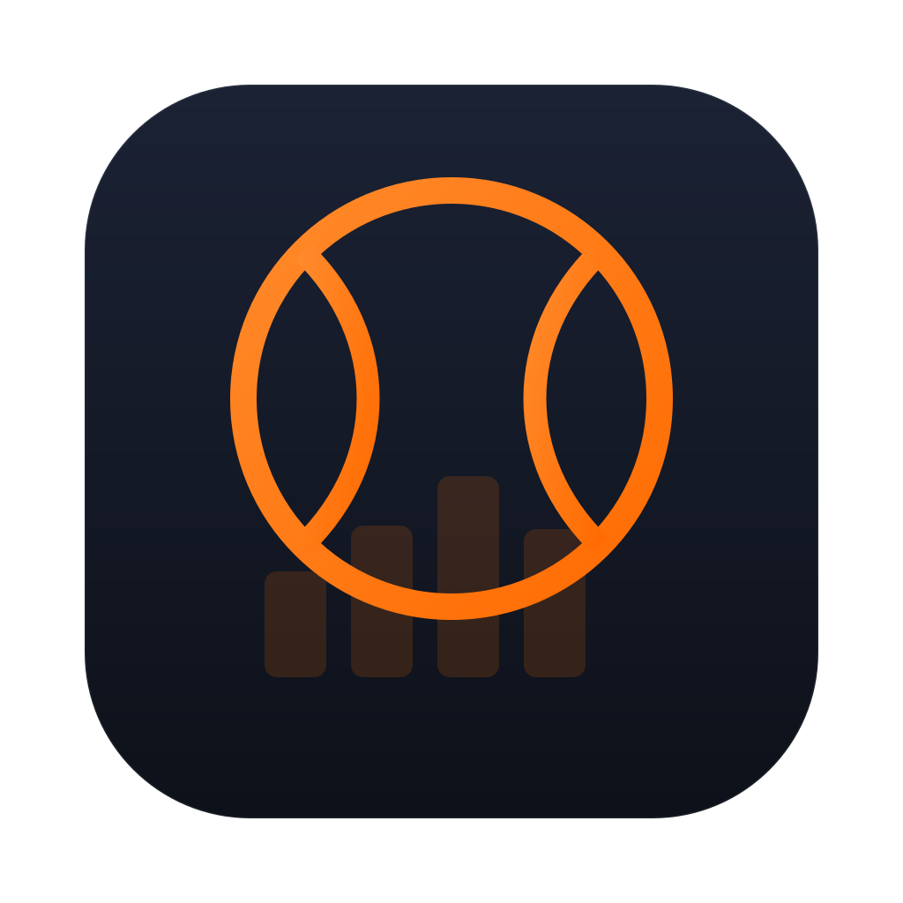

# FIP Stats Desktop

Client **desktop non ufficiale** per i dati di **FIP Stats** (statistiche della pallacanestro
FIP, piattaforma NBN23), per macOS. Replica e amplia le funzioni dell'app mobile ufficiale
usandone le stesse API, così da poter consultare i dati comodamente dal Mac — con il **proprio
account** FIP Stats (incluso l'account Gold, se posseduto).

> ⚠️ **Progetto personale e non ufficiale.** Non è affiliato né approvato da FIP o NBN23.
> Usa le API private dell'app ufficiale (versione Android 2.13.0), che possono cambiare o
> smettere di funzionare in qualsiasi momento. Serve un tuo account FIP Stats: l'app **non**
> aggira l'abbonamento Gold, si limita ad accedere con le tue credenziali.

<p align="center">
  
</p>

---

## Caratteristiche

- **Login con il tuo account** (email e password), come nell'app ufficiale. Supporta account
  **Gold** e **Fan**: in modalità Fan compare un avviso dove alcuni dati sono limitati.
- **Home** con i prossimi incontri e i risultati delle squadre che segui.
- **Ricerca** di campionati, squadre e giocatori; dai titoli di sezione si aprono *tutti* i
  risultati di quella categoria, non solo i primi.
- **Campionati**: calendario giornata per giornata (con apertura automatica sulla giornata
  della prossima partita), classifica, classifiche giocatori e numeri complessivi del torneo.
- **Squadre**: calendario e risultati, rosa con statistiche per giocatore, statistiche di
  squadra, classifica e **quintetti** (lineup) con minuti e punti.
- **Partite**: tabellino completo, leader della gara, flusso punteggio, mappa dei tiri,
  **play-by-play** azione per azione e formazioni.
- **Giocatori**: statistiche nel campionato, andamento gara per gara e carriera completa
  (profilo unico su più stagioni/squadre).
- **Segui squadre e campionati** direttamente dal desktop, con un tasto nella pagina della
  squadra o del campionato (si sincronizza con i "Seguiti" dell'app sul telefono).
- **Esportazione CSV** di tabelle e classifiche.
- Navigazione con cronologia (tasto Indietro) che ricorda anche la scheda in cui ti trovavi.
- Interfaccia in **italiano**, tema scuro.

---

## Installazione (consigliata, senza terminale)

Se nella sezione **[Releases](../../releases)** del repository è presente il file
`FIP Stats Desktop-1.0.0-arm64.dmg`:

1. Scarica il `.dmg`.
2. Fai doppio clic per aprirlo e **trascina** l'icona *FIP Stats Desktop* nella cartella
   **Applicazioni**.
3. Apri l'app dalla cartella Applicazioni. **Al primo avvio**, siccome l'app non è firmata con
   un certificato Apple a pagamento, macOS chiede conferma: fai **clic destro sull'app → Apri**,
   poi di nuovo **Apri** nella finestra che compare. Da quel momento parte con un normale doppio clic.

> Richiede un **Mac con chip Apple (M1 o successivi)**.
>
> Se macOS dicesse che l'app *«è danneggiata e non può essere aperta»* (succede con le app non
> firmate scaricate da internet), rimuovi la quarantena una volta sola da Terminale:
> ```
> xattr -dr com.apple.quarantine "/Applications/FIP Stats Desktop.app"
> ```
> e riapri l'app. È l'unico caso in cui serve il Terminale, e solo per questo passaggio.

---

## Avvio da sorgente (sviluppatori)

Serve [Node.js](https://nodejs.org) 18 o successivo.

```bash
npm install     # installa le dipendenze (Electron, electron-builder)
npm start       # avvia l'app in modalità sviluppo
```

## Creare l'installer (.dmg) da sé

Dalla cartella del progetto, su un **Mac con chip Apple**:

```bash
npm install
npm run dist
```

Al termine trovi in `dist/`:

- `FIP Stats Desktop-1.0.0-arm64.dmg` — l'installer da distribuire (doppio clic → trascina in Applicazioni);
- `FIP Stats Desktop-1.0.0-arm64-mac.zip` — l'app già pronta (scompatti e trascini in Applicazioni).

> Il build dell'installer per macOS funziona **solo su macOS** (usa gli strumenti di sistema
> `hdiutil`/`codesign`). L'app viene firmata *ad-hoc* automaticamente: è ciò che permette
> l'apertura con clic destro → Apri, pur non essendo firmata con un Apple Developer ID.

---

## Struttura del progetto

```
fip-stats-desktop/
├─ main.js            # processo principale Electron: finestra, IPC, storage, salvataggio CSV
├─ preload.js         # ponte sicuro (contextBridge) tra interfaccia e processo principale
├─ src/
│  ├─ api.js          # login Firebase, rinnovo token, chiamate GraphQL, gestione sessione
│  └─ queries.js      # query e mutation GraphQL estratte dall'app ufficiale
├─ renderer/          # interfaccia (HTML/CSS/JS, senza passaggi di build)
│  ├─ index.html
│  ├─ app.js
│  └─ styles.css
├─ build/
│  └─ icon.png        # icona dell'app (electron-builder la converte in .icns)
└─ package.json
```

---

## Sicurezza e privacy

- La **password non viene mai salvata né registrata**: è usata solo al momento del login per la
  singola richiesta a Firebase, poi scartata (il campo del form viene svuotato). Nessuna query al
  server di FIP la riceve, quindi non è recuperabile dall'app.
- L'unica credenziale conservata è il **token di sessione**, cifrato con il **Portachiavi di
  macOS** (`safeStorage`). Se la cifratura non fosse disponibile, il token **non** viene scritto
  su disco (resta solo in memoria).
- Finestra con `contextIsolation` attivo e `nodeIntegration` disattivato; l'interfaccia non ha
  accesso diretto al file system.
- Nella **build di distribuzione** gli **strumenti per sviluppatori (DevTools) sono disattivati**,
  così chi ha accesso fisico al Mac non può ispezionare i token di sessione.
- Nessun dato viene inviato a terzi: l'app comunica **solo** con Firebase (login) e con il server
  di FIP Stats (dati).

---

## Avvertenze

Software fornito "così com'è", per uso personale e a scopo di studio/interoperabilità. Rispetta i
Termini di Servizio di FIP/NBN23 e usa esclusivamente il tuo account. Le API sono private e non
documentate: possono cambiare senza preavviso.
